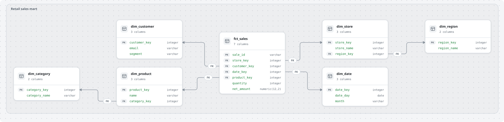
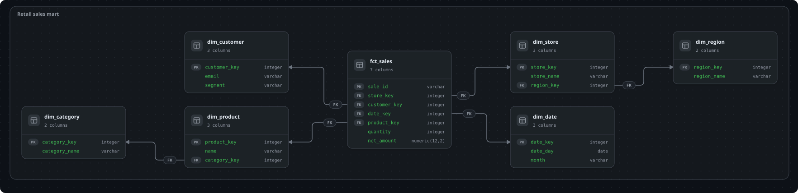
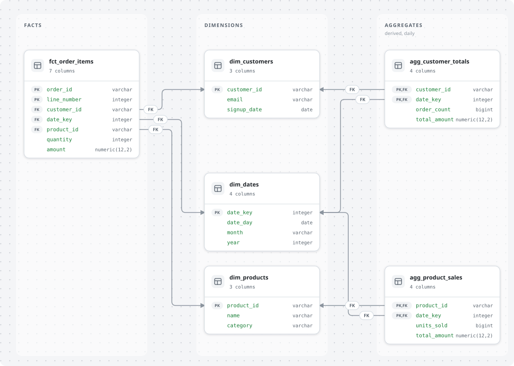
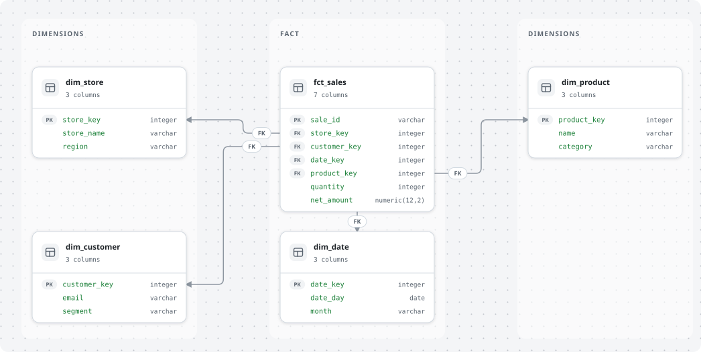
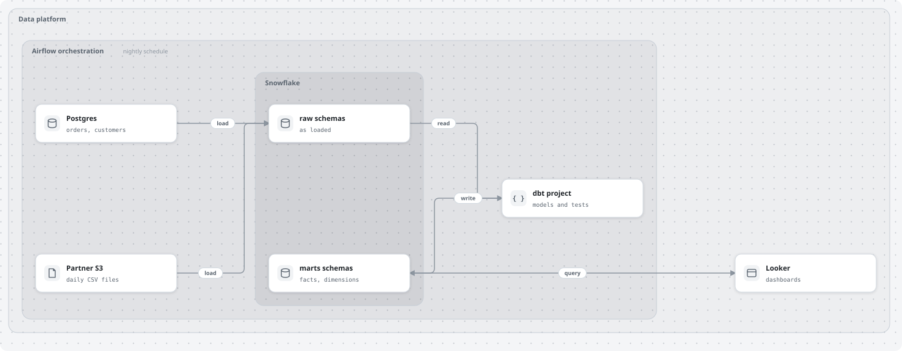
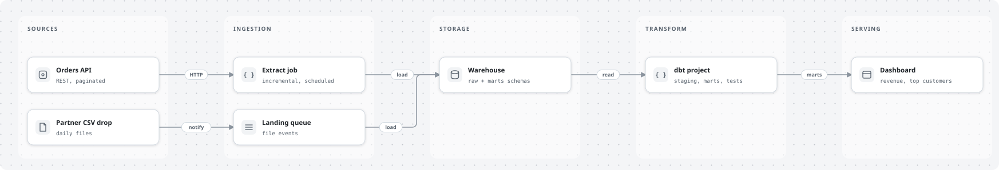
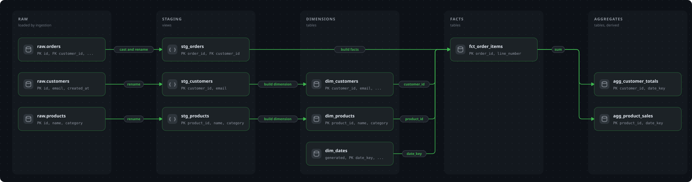

# plumbline

Straight lines for crooked data pipelines.

An agent skill that draws clean, hand-laid SVG diagrams for data work: lineage, pipeline data flow, architecture, and data models (ERDs, star and snowflake schemas). Output follows the look of PR Lens: dotted background, soft lanes, white cards with icon chips, state colours, optional dark theme and animation.

It works with any coding agent that supports the open [agent skills](https://skills.sh) format (Claude Code, Codex, Cursor, Copilot, Gemini CLI and others). The skill carries its own renderer, a single Python file with no dependencies.



## Why

Auto-layout diagram tools decide where nodes go. For data stages that usually means nodes wrap two per row, stagger diagonally from stage to stage, and lines loop around the outside to fit their labels. A lineage reads best when every stage is a column and every chain stays on one row.

This skill lets the agent place each node explicitly, then routes every line for you:

- lines leave the right side of a box and enter the left side, so flow reads left to right
- same-row lines are straight, and lines into one target can merge into a shared trunk or each take their own vertical lane
- a built-in check warns when a line would cross a card or a label does not fit its gap

## Gallery

| | |
|---|---|
| **Star schema, automatic layout** (fact in the middle, snowflake sub-dimensions beside their parent) | **Same, dark theme** |
|  |  |
| **Explicit lanes** (facts and aggregates in separate lanes, each FK line in its own vertical lane) | **Fact in the middle with explicit lanes** |
|  |  |
| **Nested architecture** (box in box in box) | **Architecture, flat** |
|  |  |
| **Lineage by stage, dark** | |
|  | |

The specs behind these images are in [`skills/plumbline/assets/examples/`](skills/plumbline/assets/examples/).

## Install

```bash
# from GitHub
npx skills add iadan92/plumbline

# from a local clone
npx skills add ./plumbline
```

Useful flags: `-g` installs for your user instead of the current project, `-a <agent>` targets one agent, `--list` shows what a repository offers without installing, `--copy` copies files instead of symlinking.

Requirements: Python 3.8 or newer. No packages. The optional preview helper uses macOS Quick Look and is skipped elsewhere.

## Use

Ask the agent in plain language. It decides when the skill applies.

```text
Draw the lineage of our dbt project left to right: raw, staging, marts and aggregates as columns,
orders on the top row, animated, for the README.

Draw a true star schema for fct_sales with dim_store, dim_customer, dim_date and dim_product.
dim_product is snowflaked into dim_category. One box, columns listed, PK/FK marked, light and dark.

Architecture diagram for our nightly pipeline: Airflow as an outer box around Postgres and S3 sources,
Snowflake (raw and marts schemas inside it) and dbt, with Looker as a separate serving box.
```

What happens: the agent writes a small JSON spec, runs the renderer, looks at the result in slices, fixes warnings, and hands you the SVG. You can ask for changes ("move the fact to the left", "dark version", "animate it") and it edits the spec, not the picture.

Run the renderer yourself:

```bash
python3 skills/plumbline/scripts/render_diagram.py spec.json out.svg \
    [--theme light|dark] [--animate none|packets|dashes]
```

## Spec

```json
{
  "title": "Lineage by stage",
  "options": {"gap": 150, "lines": "merge", "theme": "light", "animate": "none"},
  "lanes": [{"id": "raw", "label": "raw", "sub": "loaded by ingestion"}],
  "nodes": [{"id": "raw_orders", "title": "raw.orders", "lane": "raw", "row": 0,
             "sub": "PK id, FK customer_id", "glyph": "db", "state": "added"}],
  "edges": [{"from": "raw_orders", "to": "stg_orders", "label": "cast and rename"}]
}
```

| Part | What it does |
|---|---|
| `lanes` | Columns, left to right. Lane order is the layout. |
| `nodes` | Cards. `lane` and `row` place them; equal rows align horizontally. `glyph`: `db`, `module`, `table`, `service`, `ui`, `queue`, `file`. `state`: `unchanged` (grey), `added` (green), `modified` (amber), `removed` (red). |
| `nodes[].columns` | Turns a card into a table: `[{"name", "type", "key"}]` with `key` of `PK`, `FK`, `PK,FK` or null. Edges can attach to a column with `from_col` and `to_col`. |
| `edges` | `from`, `to`, short `label`, optional `style: "dotted"`, `state`, `step` (animation order). |
| `groups` | Nested boxes around nodes or other groups, any depth. Use for containers such as an orchestrator around a pipeline. |
| `layout: "star"` | Automatic star or snowflake layout. Give only tables and FK edges. |
| `options.lines` | `merge` (shared trunk per target, good for lineage) or `lanes` (own vertical lane per line, needed for ERDs). |
| `options.flip` | Mirrors the lane order. |
| `options.show_lanes` | `false` hides lane backgrounds, useful with groups. |

The full guide for the agent, including layout rules, is in [`SKILL.md`](skills/plumbline/SKILL.md).

### Layout rules that matter

- Flow reads left to right. One table per cell, listed vertically in its stage.
- Put the main entity (for example orders) on the top row so its straight line to the fact is the first thing the eye follows.
- Do not invent upstream tables for generated ones: a date dimension from a date spine stands alone and says "generated".
- Keep labels to one or two words and the gap wider than the label. Long labels are the usual reason lines get pushed into loops in other tools.
- For ERDs, give each FK line its own vertical lane. Lines may cross, but each stays followable.

## Notes on data models

`skills/plumbline/references/modeling-notes.md` collects conventions reviewers check: state the fact grain, use an order-line fact with a composite key instead of one product per order, let aggregates keep the conformed dimensions, give aggregates a time grain, and avoid storing the same metric in a dimension and an aggregate. Conventions vary by team; treat the notes as guidance.

## Limits

- Static drawings. The renderer places and routes what you specify; it does not lay out cycles or very large graphs. Past about 15 nodes per stage, generate lineage from the project instead (for example `dbt docs generate`).
- Animation uses SMIL (a dot travels along each connection, stage by stage). It plays in browsers and in images rendered by GitHub, not in every viewer. Playback was not tested in all of them; the markup follows the structure PR Lens uses.
- The light and dark themes use the PR Lens palette. The visual style is inspired by [PR Lens](https://github.com/coldteadotai/pr-lens) (MIT, Coldtea AI); no PR Lens code is used. This project is independent and not affiliated with or endorsed by PR Lens.
- Trigger behaviour: in a measurement of 20 queries (10 that should use the skill, 10 that should not), the skill was picked on 7 of 10 and on none of the others. It triggers most reliably when the request mentions diagrams, lineage, ERDs or star schemas explicitly.

`skills/plumbline/references/pr-lens-notes.md` records what was learned about PR Lens' own layout engine (hints that have no effect, why lines loop, how lane order is decided) in case you use PR Lens directly.

## Repository layout

```text
plumbline/
  README.md
  LICENSE
  skills/plumbline/     the installable skill
    SKILL.md                    instructions for the agent
    scripts/render_diagram.py   the renderer (stdlib only)
    scripts/preview_slices.py   macOS preview in slices (Quick Look crops wide SVGs)
    assets/examples/*.json      example specs
    references/                 modelling notes and PR Lens notes
  examples/                     rendered SVGs used in this README
  tools/                        build_examples.py (re-render + smoke test), trigger_check.py
  evals/                        task prompts and trigger queries used to test the skill
```

## Development

```bash
python3 tools/build_examples.py     # re-render examples, exits non-zero on a warning or invalid SVG
python3 tools/trigger_check.py evals/trigger-evals.json out.json   # does the installed skill get picked? (needs the Claude Code CLI)
```

`evals/evals.json` holds the task prompts used to compare outputs with and without the skill. `evals/trigger-evals.json` holds 20 queries (10 that should use the skill, 10 near misses that should not).

When changing the renderer, re-render the examples and look at them. A single macOS Quick Look call crops wide diagrams; use `preview_slices.py` to inspect every part.

## License

MIT, see [LICENSE](LICENSE).
