# plumbline

Straight lines for crooked data pipelines.

An agent skill that draws clean SVG diagrams for data work: lineage, pipeline data flow, sequence diagrams, architecture, and data models (ERDs, star and snowflake schemas). Output follows the look of PR Lens: dotted background, soft lanes, white cards with icon chips, state colours, light, dark and brand themes, optional animation.

It works with any coding agent that supports the open [agent skills](https://skills.sh) format (Claude Code, Codex, Cursor, Copilot, Gemini CLI and others). The skill carries its own renderer, plain Python with no dependencies. Only the PNG, PDF and GIF export also needs Node.js.


## What it does

| | |
|---|---|
| **Draws** | lineage and dbt DAGs, data flow, architecture with nested boxes, sequence diagrams, ERDs, star and snowflake schemas |
| **Places nodes for you, or exactly where you say** | leave `lane` and `row` out and stages and chains are laid out automatically; pin any node and the pin always wins |
| **Imports** | a dbt `manifest.json` (with dbt's `--select` syntax) or SQL DDL (Postgres, MySQL, Snowflake, BigQuery, SQL Server) |
| **Compares versions** | `diff_specs.py old new` marks what was added, changed and removed, down to columns, with ADDED, CHANGED, REMOVED chips and a legend; `--git REV` compares with a commit |
| **Themes** | light, dark, print, and your own brand palette and font from a small JSON file |
| **Exports** | SVG, animated SVG, PNG, PDF and an animated GIF, on macOS, Linux and Windows |
| **Checks itself** | a spec validator that names the exact wrong field, line-through-card warnings, 79 tests, and CI that re-renders every example byte for byte |

## Why

Auto-layout diagram tools decide where nodes go. For data stages that usually means nodes wrap two per row, stagger diagonally from stage to stage, and lines loop around the outside to fit their labels. A lineage reads best when every stage is a column and every chain stays on one row.

The renderer keeps the data-reading conventions (a stage per column, a chain per row), places nodes that the spec leaves open by those rules, and lets the agent or the user pin any node explicitly. Then it routes every line:

- lines leave the right side of a box and enter the left side, so flow reads left to right
- same-row lines are straight, and lines into one target can merge into a shared trunk or each take their own vertical lane
- a built-in check warns when a line would cross a card or a label does not fit its gap

## Gallery

| | |
|---|---|
| **Star schema, automatic layout** (fact in the middle, snowflake sub-dimensions beside their parent) | **Same, dark theme** |
|  |  |
| **Explicit lanes** (facts and aggregates in separate lanes, each FK line in its own vertical lane) | **Fact in the middle with explicit lanes** |
|  |  |
| **Nested architecture** (box in box in box) | **Architecture, flat** |
|  |  |
| **Automatic layout** (no lanes, no rows; `layer` names the stages) | **Lanes named, rows automatic, two nodes pinned** (payments on the top row) |
| 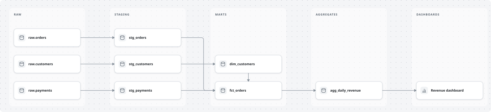 | 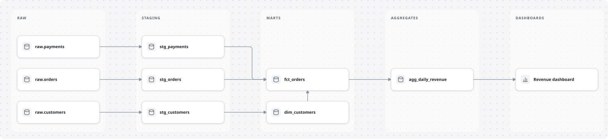 |
| **Imported from a dbt manifest** (`import_dbt.py`, selected with `--exclude "tag:legacy"`) | **Imported from SQL DDL** (`import_ddl.py`) |
| 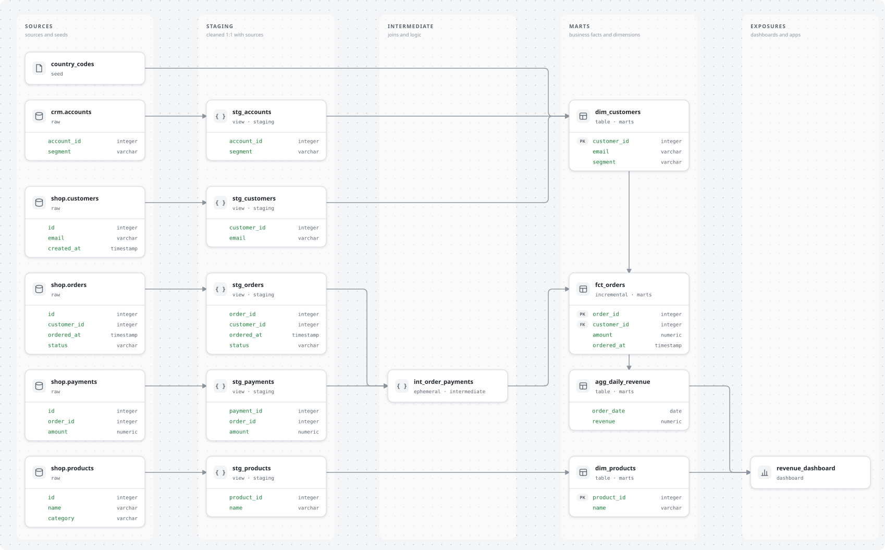 | 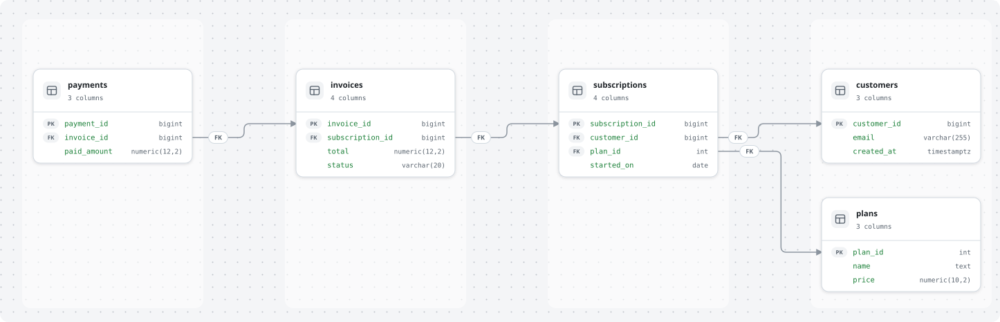 |
| **Lineage diff**: added, changed, removed | **Data model diff**: column level |
| 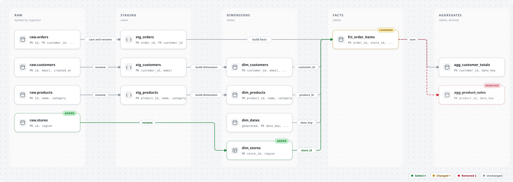 | 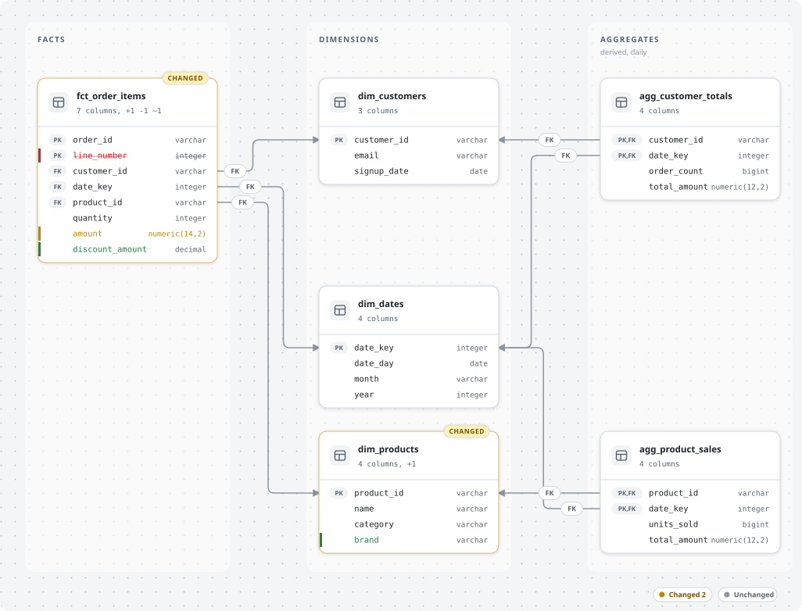 |
| **Sequence diff** | **Brand theme** (`--theme-file`) |
| 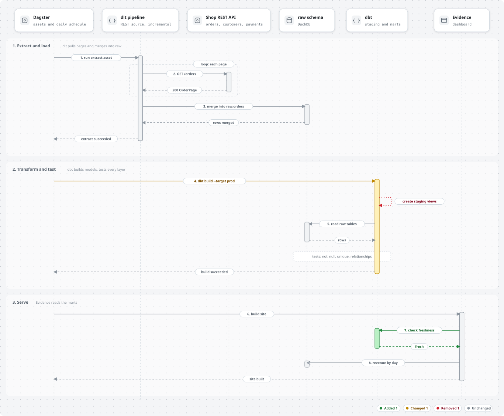 | 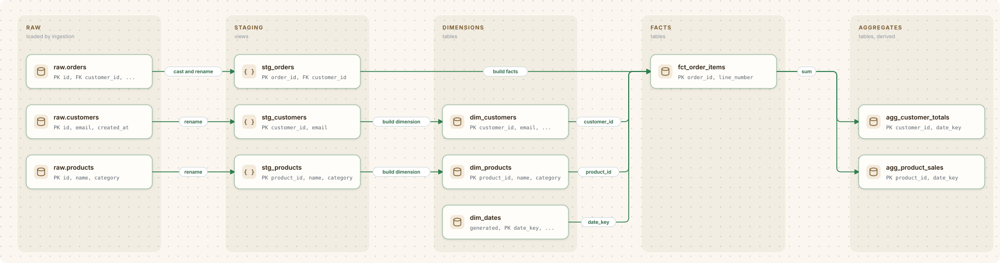 |
| **Print theme** | **Animated GIF** (`export.py spec.json flow.gif`) |
| 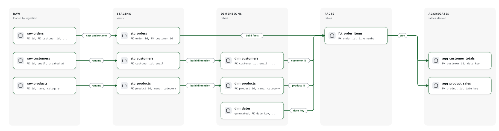 | 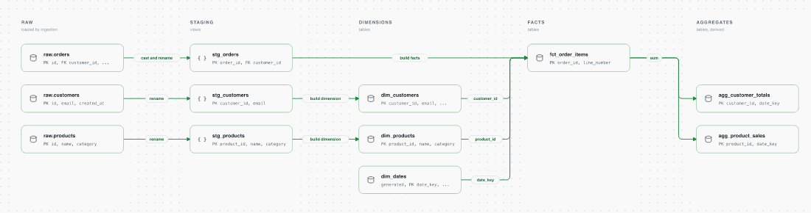 |
| **Lineage by stage, dark** | **Sequence diagram** (who calls whom, three phases) |
|  | 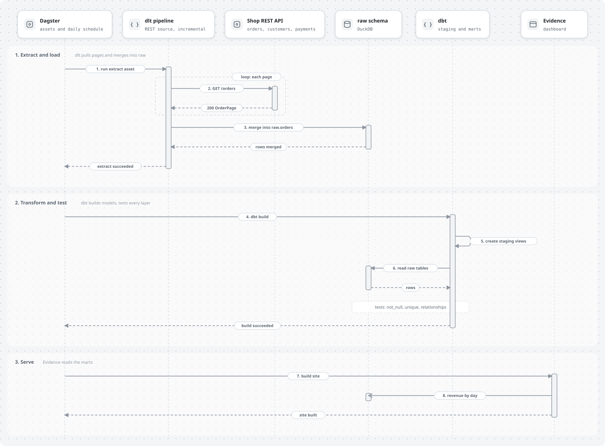 |
| **Sequence, dark** | **Sequence, headers per phase** (PR Lens style) |
| 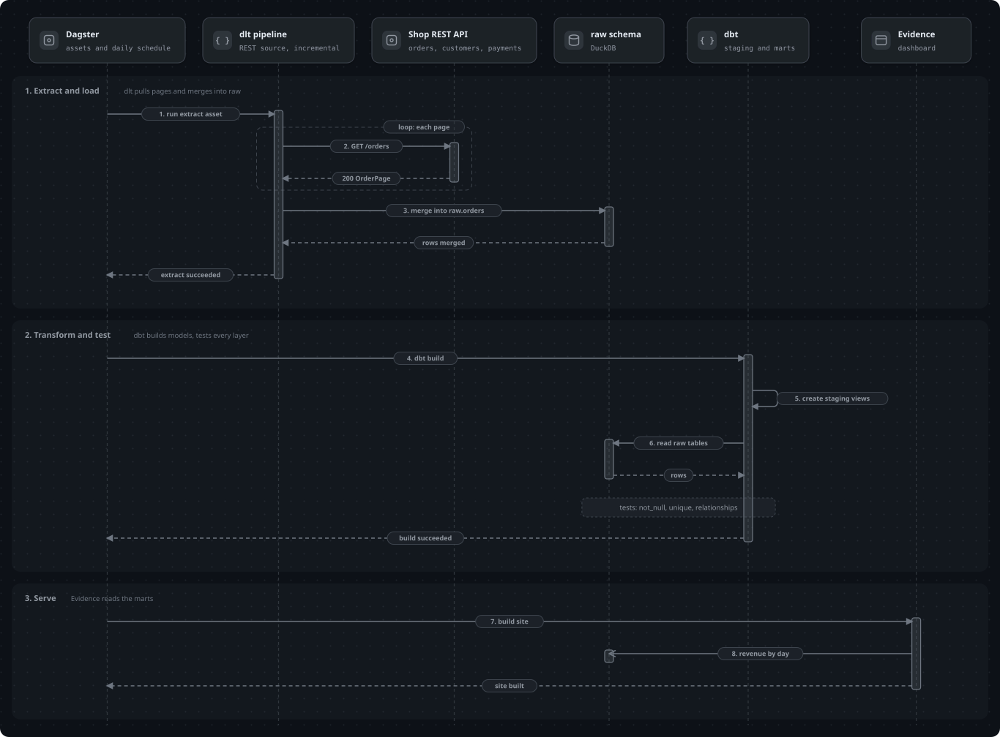 | 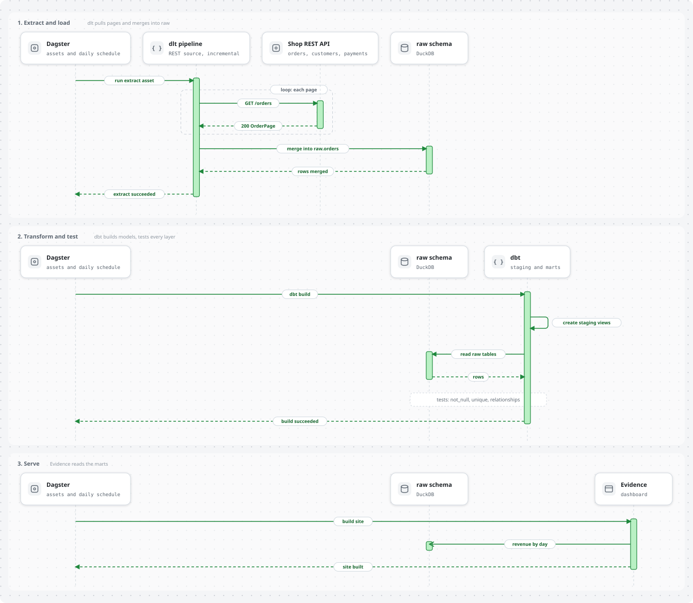 |

The specs behind these images are in [`skills/plumbline-svg-diagrams/assets/examples/`](skills/plumbline-svg-diagrams/assets/examples/).

## Install

```bash
# from GitHub
npx skills add iadan92/plumbline          # installs the skill plumbline-svg-diagrams

# from a local clone
npx skills add ./plumbline
```

### Reliable activation in Claude Code: the plugin

An agent decides whether to open a skill from its one-line description, and in a busy setup (many skills, hooks, a terse output style) it often does not: it starts writing SVG by hand, or asks questions first. Measured on 40 held-out queries, twice each, on a machine with a dozen other skills and plugins installed, the skill alone was picked on 10% of the requests that should use it (8 of 80), and on none of the 70 that should not. Rewording the description four different ways moved this between 19% and 29% on a separate set, which is noise: wording is not the lever.

The lever is a hook. This repository is also a Claude Code plugin; its `UserPromptSubmit` hook ([`hooks/route_to_skill.py`](hooks/route_to_skill.py), standard library, about 60 lines) adds one short reminder to prompts that ask for a data diagram: use the skill first, before writing SVG or asking questions. It stays silent for everything else and when you name another tool (Mermaid, PlantUML, Excalidraw, draw.io). With the plugin the same 40 queries triggered the skill on 80 of 80 runs, with 0 of 70 false triggers.

```text
/plugin marketplace add iadan92/plumbline
/plugin install plumbline@plumbline
```

The plugin includes the skill, so do not install both. The hook needs `python3` on the PATH. The numbers come from one machine and one model; `tools/trigger_check.py --plugin-dir . ` repeats them on yours. The hook's patterns were written for English prompts and were checked against 92 labelled queries, 20 of them written after the first version and used once before the patterns were widened, so treat the result as strong evidence, not a guarantee. Other agents (Codex, Cursor, Gemini CLI) get the skill only; ask for it by name there when it does not fire.

Useful flags: `-g` installs for your user instead of the current project, `-a <agent>` targets one agent, `--list` shows what a repository offers without installing, `--copy` copies files instead of symlinking.

Requirements: Python 3.8 or newer, no packages. `export.py` (PNG, PDF, GIF) also needs Node.js 18 or newer; its first run installs two npm packages (`@resvg/resvg-js`, `gifenc`) into `~/.cache/plumbline`. The optional `preview_slices.py` uses macOS Quick Look; on other systems export a PNG instead.

## Use

Ask the agent in plain language. It decides when the skill applies.

```text
Draw the lineage of our dbt project left to right: raw, staging, marts and aggregates as columns,
orders on the top row, animated, for the README.

Draw a true star schema for fct_sales with dim_store, dim_customer, dim_date and dim_product.
dim_product is snowflaked into dim_category. One box, columns listed, PK/FK marked, light and dark.

Architecture diagram for our nightly pipeline: Airflow as an outer box around Postgres and S3 sources,
Snowflake (raw and marts schemas inside it) and dbt, with Looker as a separate serving box.

Draw the lineage upstream of fct_orders from target/manifest.json.

Here is schema.sql: draw the ERD. Then show what changed against the version on main, with labels.

Make that pipeline diagram an animated GIF for the slide, in our brand colours.
```

What happens: the agent writes (or imports) a small JSON spec, runs the renderer, looks at the result, fixes warnings, and hands you the SVG. You can ask for changes ("move the fact to the left", "put payments on the top row", "dark version", "animate it") and it edits the spec, not the picture.

Run the tools yourself (paths relative to `skills/plumbline-svg-diagrams/scripts/`):

```bash
python3 render_diagram.py spec.json out.svg [--theme light|dark|print] [--animate none|packets|dashes] \
        [--theme-file brand.json] [--resolve pinned.json] [--validate]
python3 import_dbt.py target/manifest.json -o spec.json --select "+fct_orders" --columns 6
python3 import_ddl.py schema.sql -o spec.json
python3 diff_specs.py old.json new.json -o diff.json --summary      # or: --git HEAD~1 spec.json
python3 export.py out.svg out.png                                   # also .pdf; spec.json to .gif
```

## Spec

```json
{
  "title": "Lineage by stage",
  "options": {"gap": 150, "lines": "merge", "theme": "light", "animate": "none"},
  "lanes": [{"id": "raw", "label": "raw", "sub": "loaded by ingestion"}],
  "nodes": [{"id": "raw_orders", "title": "raw.orders", "lane": "raw", "row": 0,
             "sub": "PK id, FK customer_id", "glyph": "db", "state": "added"}],
  "edges": [{"from": "raw_orders", "to": "stg_orders", "label": "cast and rename"}]
}
```

| Part | What it does |
|---|---|
| `lanes` | Columns, left to right. Lane order is the layout. |
| `nodes` | Cards. `lane` and `row` place them (both optional; a pin beats automatic placement); equal rows align horizontally. `layer` names the lanes when every node has one. `glyph`: `db`, `warehouse`, `module`, `table`, `service`, `ui`, `queue`, `file`, `bucket`, `orchestrator`, `chart`, `cloud`, `api`, `stream`, `transform`, `user`, `clock` (inferred from the name when left out); `icon` takes your own SVG path. `state`: `unchanged` (grey), `added` (green), `modified` (amber), `removed` (red). |
| `nodes[].columns` | Turns a card into a table: `[{"name", "type", "key"}]` with `key` of `PK`, `FK`, `PK,FK` or null. Edges can attach to a column with `from_col` and `to_col`. |
| `edges` | `from`, `to`, short `label`, optional `style: "dotted"`, `state`, `step` (animation order). |
| `groups` | Nested boxes around nodes or other groups, any depth. Use for containers such as an orchestrator around a pipeline. |
| `type: "sequence"` | Sequence diagram: `participants`, `phases` of `messages` (`sync`, `return`, `async`, `self`, `note`), `frames`. No coordinates; see the sequence section in [`SKILL.md`](skills/plumbline-svg-diagrams/SKILL.md). |
| `layout: "star"` | Automatic star or snowflake layout. Give only tables and FK edges. |
| `options.fit_width` | Shrinks cards and gaps until the diagram fits that width in pixels. |
| `options.palette`, `font`, `mono` | Brand colours and fonts; the same keys work in a `--theme-file`. |
| `options.diff_labels`, `legend` | ADDED, CHANGED, REMOVED chips and a state key. `diff_specs.py` turns them on for you. |
| `options.lines` | `merge` (shared trunk per target, good for lineage) or `lanes` (own vertical lane per line, needed for ERDs). |
| `options.flip` | Mirrors the lane order. |
| `options.show_lanes` | `false` hides lane backgrounds, useful with groups. |

The full guide for the agent, including layout rules, is in [`SKILL.md`](skills/plumbline-svg-diagrams/SKILL.md).

### Layout rules that matter

- Flow reads left to right. One table per cell, listed vertically in its stage.
- Put the main entity (for example orders) on the top row so its straight line to the fact is the first thing the eye follows.
- Do not invent upstream tables for generated ones: a date dimension from a date spine stands alone and says "generated".
- Keep labels to one or two words and the gap wider than the label. Long labels are the usual reason lines get pushed into loops in other tools.
- For ERDs, give each FK line its own vertical lane. Lines may cross, but each stays followable.

## Notes on data models

`skills/plumbline-svg-diagrams/references/modeling-notes.md` collects conventions reviewers check: state the fact grain, use an order-line fact with a composite key instead of one product per order, let aggregates keep the conformed dimensions, give aggregates a time grain, and avoid storing the same metric in a dimension and an aggregate. Conventions vary by team; treat the notes as guidance.

## Limits

- Automatic placement is a readable default, not an optimiser. It handles flows of up to roughly 60 nodes, ignores cycles for placement and warns when a line would run through a card; a dense graph may need a few pinned nodes. The dbt importer refuses more than 60 nodes without `--force`; use `--select` to draw a slice.
- The importers read a `manifest.json` or a DDL file. They do not connect to a warehouse, and dbt manifests carry no column-level lineage.
- PDF export is a 2x raster page, not vector. A GIF uses 128 colours and the fonts installed on the machine.
- Animation uses SMIL (a dot travels along each connection, stage by stage). It plays in browsers and in images rendered by GitHub, not in every viewer. Playback was not tested in all of them; the markup follows the structure PR Lens uses.
- The light and dark themes use the PR Lens palette. The visual style is inspired by [PR Lens](https://github.com/coldteadotai/pr-lens) (MIT, Coldtea AI); no PR Lens code is used. This project is independent and not affiliated with or endorsed by PR Lens.
- Trigger behaviour: as a plain skill it is picked rarely in a busy setup (10% in the measurement above); use the plugin for Claude Code, or ask by name ("use plumbline-svg-diagrams"). The skill name contains "svg" on purpose: a name without it triggered on 0 of 11 in an earlier test.

`skills/plumbline-svg-diagrams/references/pr-lens-notes.md` records what was learned about PR Lens' own layout engine (hints that have no effect, why lines loop, how lane order is decided) in case you use PR Lens directly.

## Repository layout

```text
plumbline/
  README.md
  LICENSE
  skills/plumbline-svg-diagrams/     the installable skill
    SKILL.md                    instructions for the agent
    scripts/render_diagram.py   renderer entry point (stdlib only); render_sequence.py, layout_auto.py,
                                spec_check.py and common.py sit beside it
    scripts/import_dbt.py       dbt manifest.json to spec
    scripts/import_ddl.py       SQL DDL to spec
    scripts/diff_specs.py       two versions (or a git revision) to a diff spec
    scripts/export.py           PNG, PDF and GIF export (Node helper: raster.mjs, gifworker.mjs)
    scripts/preview_slices.py   macOS preview in slices (Quick Look crops wide SVGs)
    assets/examples/            example specs, a sample dbt manifest, sample DDL, a brand theme
    references/                 modelling notes and PR Lens notes
  .claude-plugin/               plugin and marketplace manifests (Claude Code)
  hooks/                        route_to_skill.py: the routing hook, hooks.json
  examples/                     rendered images used in this README
  tests/                        unittest suite (renderer, layout, importers, diff, export)
  tools/                        build_examples.py (re-render, smoke test, --check), trigger_check.py
  evals/                        task prompts, input files and trigger queries used to test the skill
  .github/workflows/ci.yml      tests on Python 3.8, 3.10 and 3.12, export tests, example images check
```

## Development

```bash
python3 -m unittest discover -s tests -v   # 79 tests; export tests need Node.js, skip with PLUMBLINE_SKIP_EXPORT=1
python3 tools/build_examples.py            # re-render examples, exits non-zero on a warning or invalid SVG
python3 tools/build_examples.py --check    # compare a fresh render with the committed files (CI does this)
python3 tools/trigger_check.py evals/trigger-evals.json out.json --split test --runs 2 -v   # is the skill picked? (needs the Claude Code CLI)
```

`evals/evals.json` holds the task prompts used to compare outputs with and without the skill (inputs in `evals/files/`). `evals/trigger-evals.json` holds 72 queries (41 that should use the skill, 31 near misses that should not), split into train and test so a description can be tuned on one half and judged on the other; `evals/trigger-holdout.json` holds 40 more, written later.

When changing the renderer, re-render the examples and look at them: `export.py out.svg out.png` gives a PNG to open anywhere.

## License

MIT, see [LICENSE](LICENSE).
